# Room Security

A self-hosted intrusion alarm for one room, built from cheap Zigbee sensors, a Raspberry Pi, an IP
camera and a phone app. When someone opens the door, you get a push notification, the siren
sounds, the camera turns to where it happened and records the incident, and you can watch it all
from your phone, from anywhere.

Everything that decides runs on the Pi at home. The phone is a remote control, so the alarm keeps
working when your phone is off.

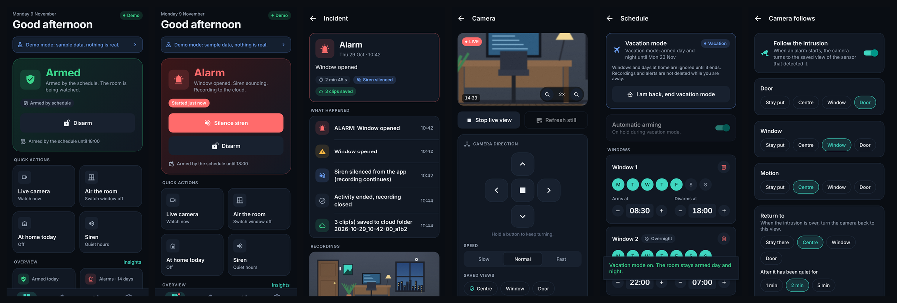

> **Demo video:** _coming soon_

## Features

- **Arm / disarm** from the phone, with exit and entry delays, or on a **weekly schedule**
  (with "at home today" days and a **vacation mode** that arms 24/7).
- **Zigbee sensors**: door and window contacts, motion, and a 105 dB siren with a silent mode.
- **Camera follow**: a pan/tilt camera turns to a saved view for each sensor that triggers, then
  returns to a resting view a few minutes later.
- **Live view** with pan/tilt pad, saved views and 1x to 4x digital zoom.
- **Incident recordings** with 30 s of pre-roll, uploaded to Google Drive while the alarm lasts,
  and played back **in the app** (streamed through the Pi, no Drive login).
- **Automatic clean-up** of recordings older than a retention period (15 days by default).
- **Push alerts** and an **activity timeline** with insights (false alarms, busiest hours, …).
- **Separate smoke detector** (ESP32-CAM + MQ-2) that alerts you even if the Pi is down.
- **Demo mode**: the app runs with sample data and no hardware, so you can try every screen.

## Screenshots

| Home | Devices | Sensor |
|:--:|:--:|:--:|
| 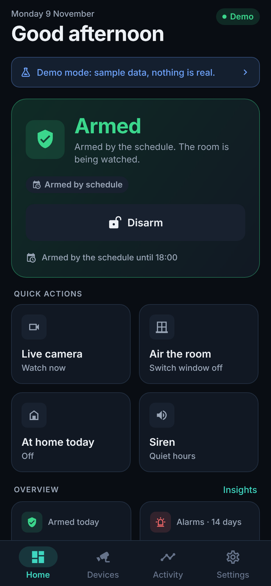 | 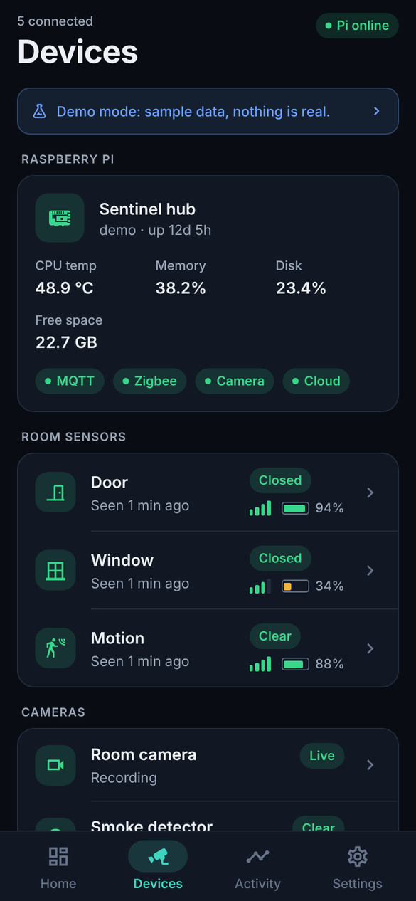 | 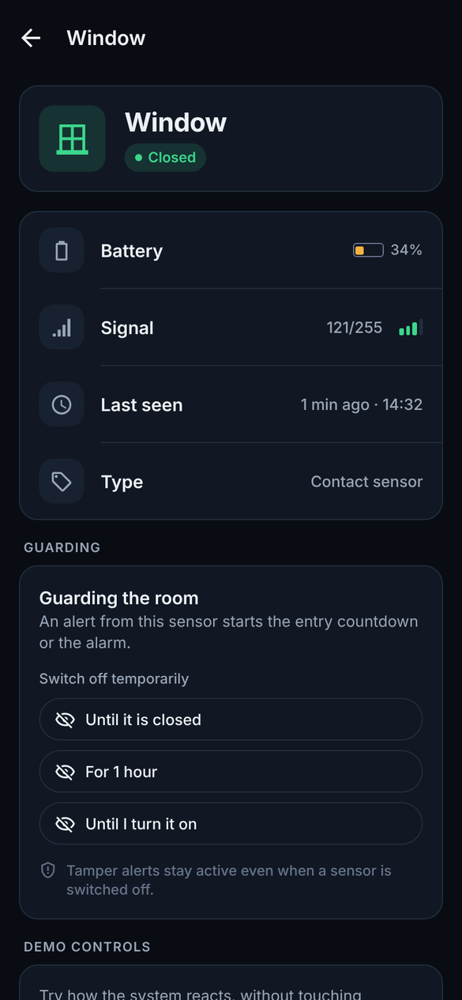 |
| **Alarm** | **Activity** | **Insights** |
| 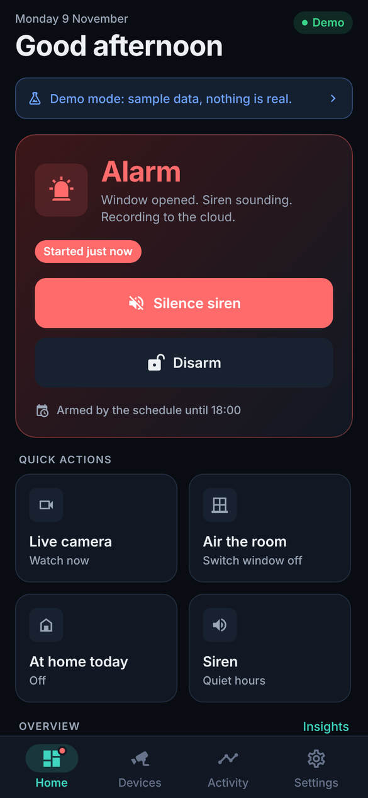 | 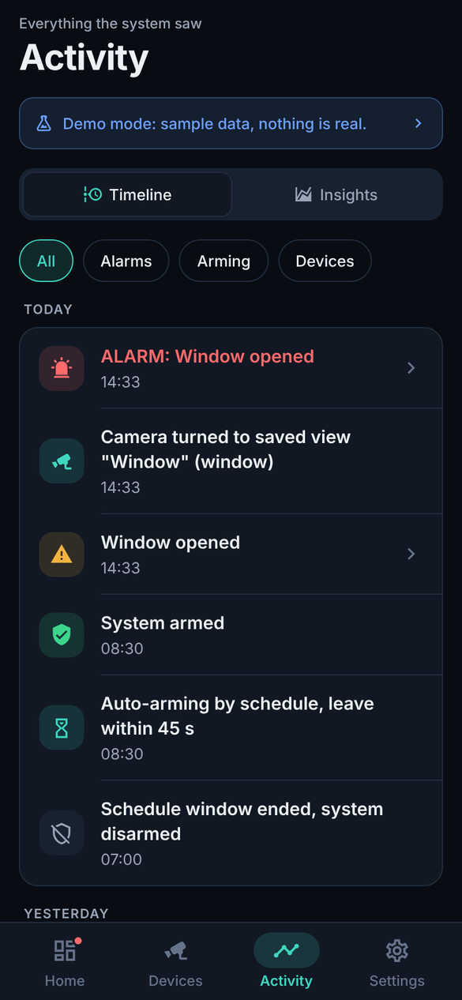 | 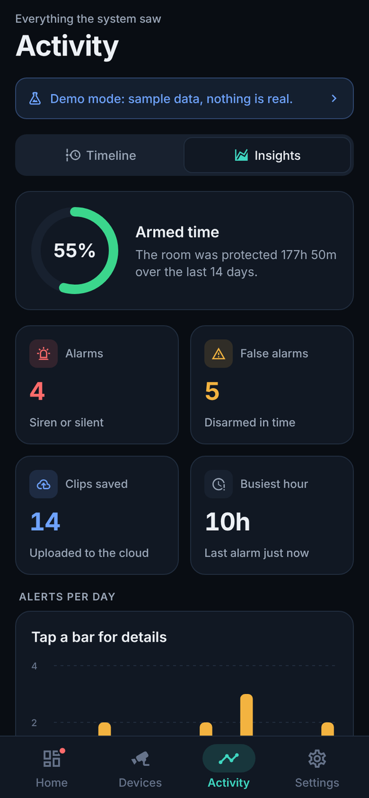 |
| **Incident with recordings** | **Clip player** | **Live camera** |
| 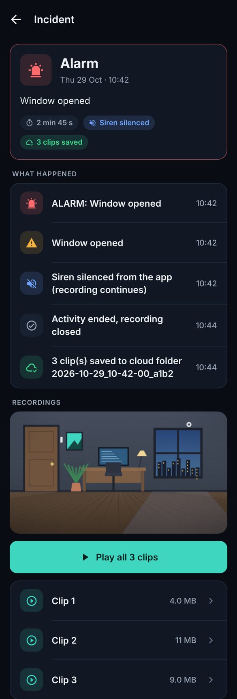 | 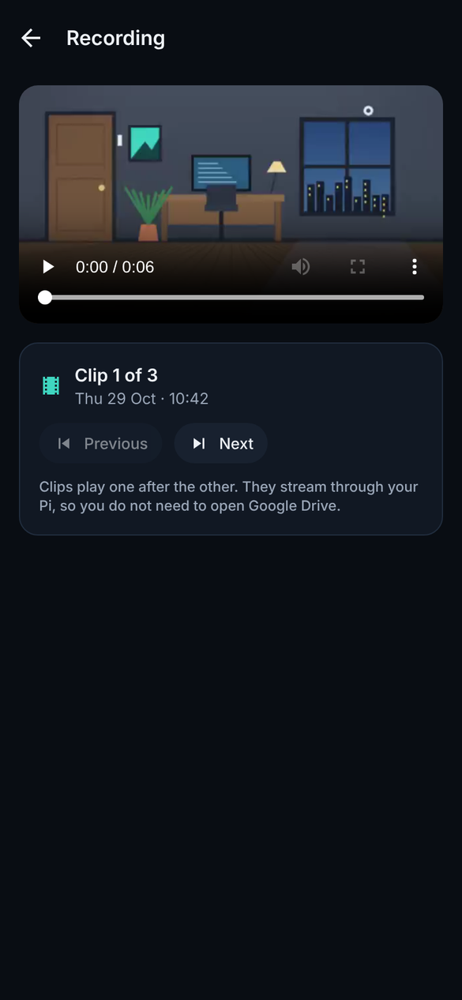 | 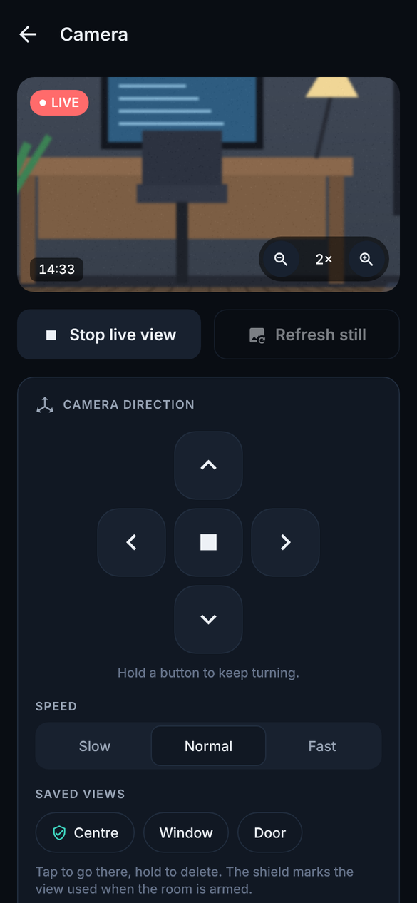 |
| **Camera follow** | **Vacation setup** | **Vacation active** |
| 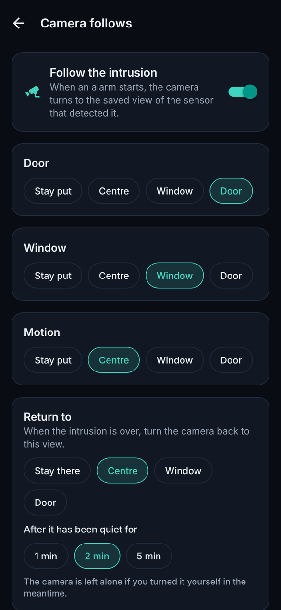 | 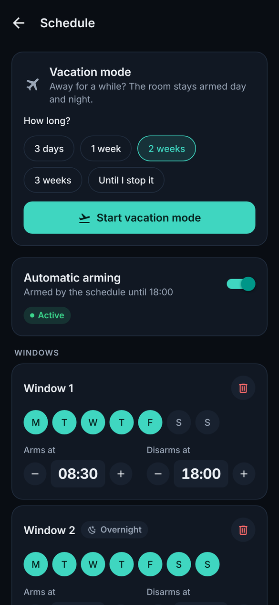 | 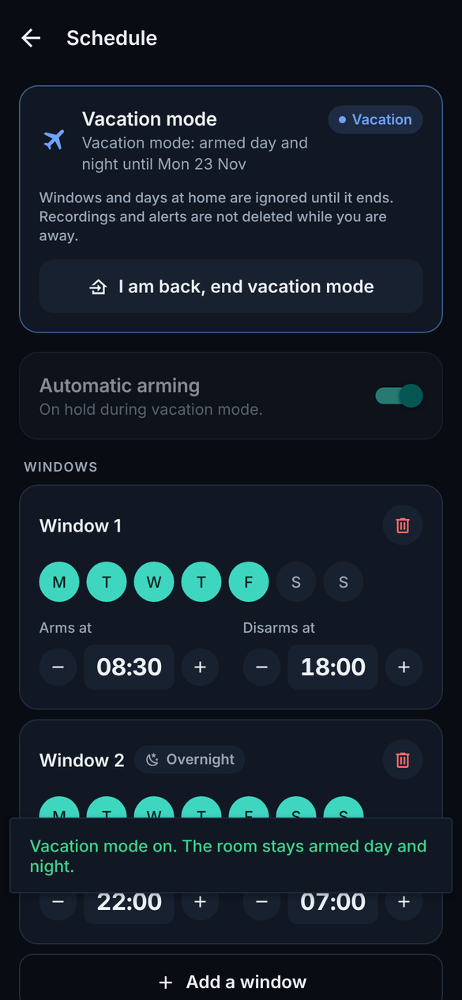 |
| **Storage** | **Settings** | **Smoke detector** |
| 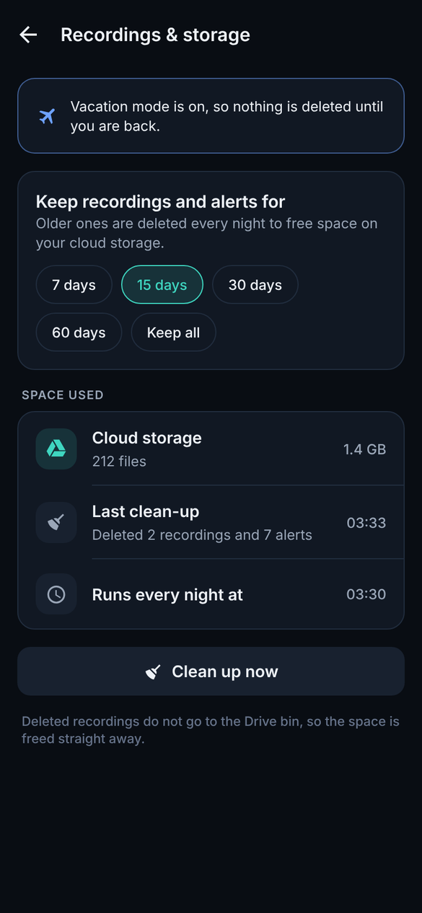 | 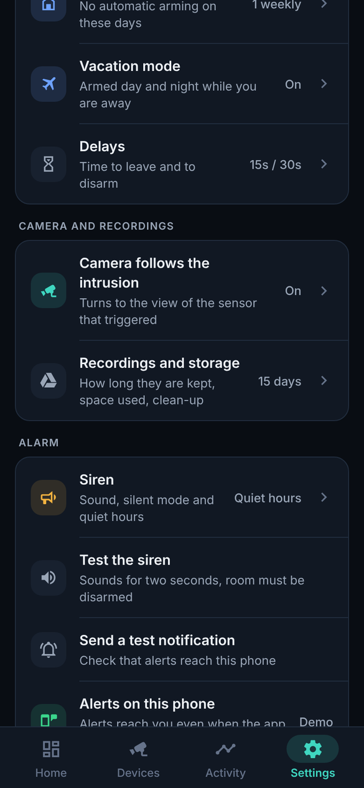 | 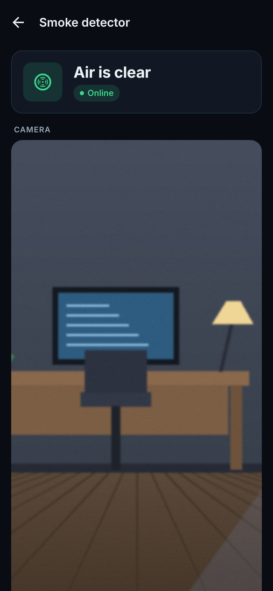 |

## How it works

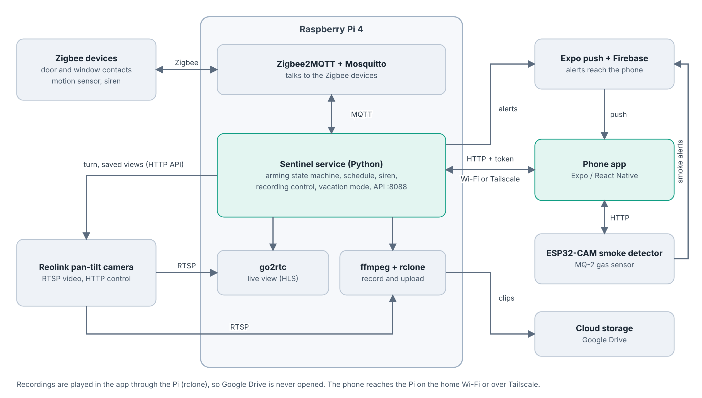

Sensors talk Zigbee to a USB dongle on the Pi. Zigbee2MQTT turns that into MQTT messages, and the
**Sentinel** service (Python, asyncio) feeds them to a pure state machine
(`disarmed -> exit delay -> armed -> entry delay -> alarm`). The state machine only emits *effects*
(siren, notify, record, aim the camera) which Sentinel executes. The app talks to Sentinel over a
small authenticated HTTP API, on the home network or through Tailscale.

Read the full write-up in **[docs/ARCHITECTURE.md](docs/ARCHITECTURE.md)**.

## Repository layout

| Folder | What |
|---|---|
| [`sentinel/`](sentinel/) | Raspberry Pi service, API, tests, `systemd` units and the [setup guide](sentinel/SETUP.md) |
| [`app/`](app/) | Expo / React Native app (SDK 58), see its [README](app/README.md) |
| [`firmware/esp32-smoke-detector/`](firmware/esp32-smoke-detector/) | Arduino sketch for the ESP32-CAM smoke detector |
| [`docs/`](docs/) | Architecture, [hardware list](docs/HARDWARE.md) and images |

## Quick start

**Try the app without any hardware**

```bash
cd app
npm install
npx expo start      # open in Expo Go; it starts in Demo mode
```

**Build the real thing**

1. Buy the parts in [docs/HARDWARE.md](docs/HARDWARE.md) (about 215 EUR for the essentials).
2. Follow [sentinel/SETUP.md](sentinel/SETUP.md) to set up the Pi (Mosquitto, Zigbee2MQTT, go2rtc,
   rclone, Tailscale, Sentinel).
3. Put the Pi's address and your API token in `app/src/config.js` and build the app
   (`npx eas-cli@latest build --profile preview --platform android`).
4. Flash `firmware/esp32-smoke-detector` to the ESP32-CAM if you want the smoke detector.

**Run the tests** (no hardware needed)

```bash
cd sentinel
python3 -m venv .venv && . .venv/bin/activate
pip install -r requirements.txt pytest
pytest
```

## Security notes

- Generate a long random API token (`openssl rand -hex 24`) and never commit it.
  `sentinel/config.yaml` is git-ignored; `app/src/config.js` ships with placeholders.
- Do not expose the API to the internet. Use the LAN or Tailscale.
- Put your own Wi-Fi name and password into the firmware only on your machine, never in a commit.

## Status

A personal project, shared as is. It is used daily, but it is not certified alarm equipment: it
cannot stop a break-in and should not be your only protection. Only film places where you have the
right to.

## Version history

The history of this repository is one commit per released version, each titled `Version x.y.z`.

## License

[MIT](LICENSE)
