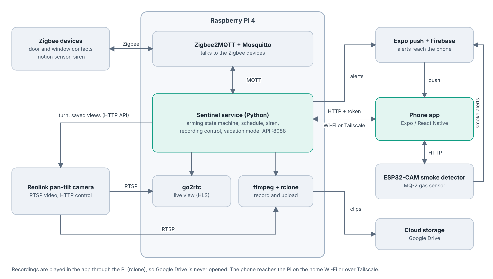
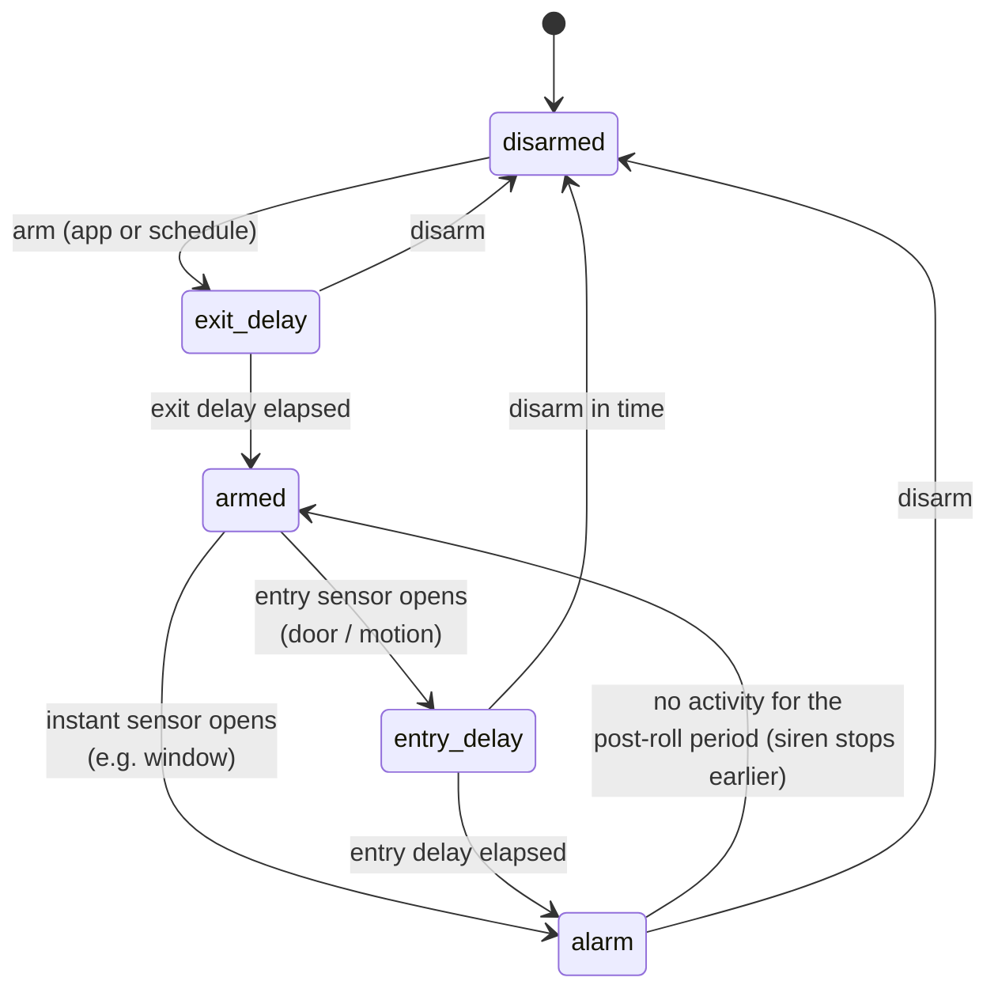
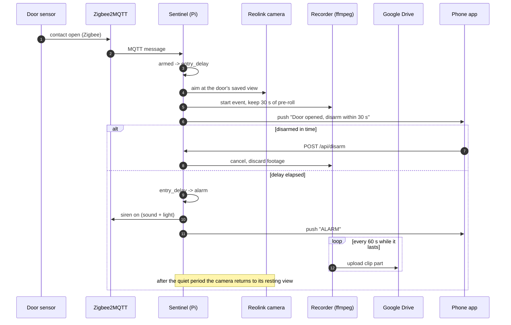

# Architecture

Room Security is a small, self-hosted intrusion-detection system for one room. Everything that
makes a decision runs on a Raspberry Pi at home; the phone app is only a remote control and a
viewer. No third-party cloud sits in the alarm path. Google Drive is used only as a cheap
off-site copy of the recordings, and Expo/FCM only to deliver push notifications.



## 1. Components

| Component | Where it runs | Role |
|---|---|---|
| **Sentinel** (`sentinel/`) | Raspberry Pi 4, Python 3 + asyncio, `systemd` service | The brain: arming state machine, sensor intake, siren, camera control, recording, upload, clean-up, push, HTTP API |
| **Zigbee2MQTT + Mosquitto** | Same Pi | Bridges the Zigbee dongle (Sonoff ZBDongle-E) to MQTT topics |
| **Zigbee devices** | Around the room | Contact sensors (SNZB-04P), motion sensor (SNZB-03P), siren (SNZB-09P) |
| **go2rtc** | Same Pi | Re-publishes the camera's RTSP stream as low-latency HLS/WebRTC for the live view |
| **ffmpeg** | Same Pi, spawned by the recorder | Keeps a rolling pre-roll buffer and writes alarm clips |
| **Reolink E1 Pro** | LAN | RTSP video, snapshots, pan/tilt and saved views through its local HTTP API |
| **rclone** | Same Pi | Uploads clips to Google Drive and lists/streams/deletes them |
| **Mobile app** (`app/`) | Phone, Expo / React Native | Arm/disarm, live view, history, settings, push alerts |
| **ESP32-CAM smoke detector** (`firmware/`) | Separate board | MQ-2 smoke sensor; pushes straight to the phone, independent of the Pi |

## 2. Design principles

- **The Pi decides, the phone asks.** All alarm logic lives on the Pi, so the alarm works with
  the phone off, out of battery or without signal. The app only sends commands and reads state.
- **A pure state machine at the core.** `engine.py` has no I/O and no clock. Every input takes an
  explicit `now` and every output is an *effect tuple* the caller executes. The whole alarm
  behaviour is therefore unit-tested with a fake clock (110 tests, no hardware needed).
- **Local first.** Sensors, siren and recording all work with the internet down. Only the
  upload and push notification need connectivity, and both are retried.
- **Private by default.** The API listens on the LAN / a Tailscale VPN, is protected by a bearer
  token, and is never exposed to the open internet.
- **Small and boring.** One process, one SQLite file, no message broker beyond local MQTT.

## 3. Arming state machine



The engine emits *effects* instead of doing work:

| Effect | Meaning |
|---|---|
| `("notify", level, title, body)` | Send a push (`info`, `warn`, `alarm`) |
| `("siren", on)` | Start or stop the siren |
| `("camera", on)` | Start or stop the ring-buffer capture |
| `("rec_start", id, ts, why)` | Begin holding footage; the pre-roll is kept |
| `("rec_alarm", id)` | The alarm is confirmed, start uploading |
| `("aim", sensor)` | Point the camera at the saved view of that sensor |
| `("rec_stop", id, outcome, stop_cam)` | Finish and upload the remaining footage |
| `("rec_cancel", id, stop_cam)` | False alarm, discard the footage |
| `("log", kind, text, id)` | Append to the activity log |

The `Sentinel` class in `main.py` owns the engine, drains its effects and turns them into real
actions (MQTT publishes, ffmpeg processes, camera commands, HTTP pushes). Background loops run on
the same event loop: the one-second tick, the recorder supervisor, the health check, the schedule
and vacation logic, the "return to" camera timer and the nightly clean-up.

## 4. What happens during an intrusion



## 5. Recording, storage and clean-up

1. **Pre-roll.** While armed, ffmpeg keeps a short rolling buffer of the camera stream so the
   footage starts *before* the first trigger (default 30 s).
2. **Event.** Footage is written in 60 s parts into a local spool folder named after the event.
   Recording continues until a quiet period (default 10 minutes after the last activity) or a
   hard cap per event.
3. **Upload.** `uploader.py` pushes finished parts to Google Drive with rclone and removes the
   local copy only after the upload succeeded. If the internet is down, parts wait on the SD card.
4. **Playback.** The app never touches Google Drive. It asks the Pi, which serves a local file if
   the part is still in the spool, or streams it from Drive with HTTP `Range` support so the video
   can seek.
5. **Retention.** A nightly job (03:30) deletes recordings and log entries older than the
   retention (default 15 days). It is skipped in vacation mode, can be run on demand from the
   Storage screen, and only ever touches folders matching the app's own naming pattern.

## 6. HTTP API

All routes require `Authorization: Bearer <token>` except `/api/health`. Source: `sentinel/api.py`.

| Area | Routes |
|---|---|
| Health and state | `GET /api/health`, `GET /api/status`, `GET /api/settings`, `POST /api/settings` |
| Arming | `POST /api/arm`, `POST /api/disarm`, `POST /api/sensors/{name}` |
| Siren | `POST /api/siren/test`, `POST /api/siren/silence` |
| Schedule | `POST /api/schedule/skip`, `/pause`, `/resume`, `POST /api/vacation` |
| History | `GET /api/events`, `GET /api/insights?days=`, `GET /api/events/{id}/clips`, `GET /api/events/{id}/clips/{name}` |
| Storage | `POST /api/cloud/cleanup` |
| Camera | `GET /api/snapshot`, `GET /api/live`, `GET /api/ptz`, `POST /api/ptz/move`, `/stop`, `/preset/go`, `/preset/save`, `/preset/delete` |
| Push | `POST /api/register`, `POST /api/unregister`, `POST /api/test-push` |

## 7. Data model

Everything is stored in one SQLite file on the Pi (`store.py`).

| Table | Columns | Purpose |
|---|---|---|
| `log` | `id, ts, kind, text, event_id, data` | Activity feed and incident history (arm, disarm, trigger, alarm, errors…) |
| `tokens` | `token` | Expo push tokens of registered phones |
| `kv` | `key, value` | Settings edited from the app (delays, schedule, vacation, camera views, retention, siren) |

Settings from `config.yaml` are only defaults. Values changed in the app are validated in
`settings.py` and persisted in `kv`, so a restart never loses them.

## 8. Security model

- **Authentication.** A single long random bearer token, compared in constant time. Generate it
  with `openssl rand -hex 24`.
- **Network.** The API is reachable on the home LAN and through Tailscale. Do not port-forward it.
- **Secrets stay out of the repo.** `sentinel/config.yaml`, the rclone config, the Firebase
  service-account key and `google-services.json` are git-ignored. The app reads its address and
  token from `app/src/config.js`, which ships with placeholders.
- **Least trust in the app.** Clip names are validated against a strict pattern before touching
  the filesystem or Drive, so a request cannot escape the recordings folder.
- **Physical.** The Pi should sit in another room so that an intruder cannot take the recorder.

## 9. Mobile app

Expo SDK 58 / React Native, React Navigation, React Native Paper.

```
app/src/
├── screens/      Home, Devices, Camera (+ PTZ pad and digital zoom), Activity,
│                 EventDetail, ClipPlayer, Schedule, CameraFollow, Storage, Settings, …
├── data/         DataProvider; real.js (HTTP client to the Pi) and demo.js (offline demo data)
├── navigation/   Tab bar and stacks
├── ui/           Small design system (cards, buttons, forms, feedback, haptics)
├── theme/        Light/dark tokens and persistence
├── charts/       Lightweight charts for the Insights tab
└── lib/          Helpers (saved views, formatting)
```

The `DataProvider` hides where data comes from. In *real* mode it calls the Pi; in *demo* mode it
serves built-in sample data, which is how the screenshots in this repo were produced without any
hardware.

## 10. Smoke detector (separate subsystem)

An AI-Thinker ESP32-CAM with an MQ-2 sensor on GPIO13 runs its own firmware. It serves
snapshots and an alert history from its SD card and sends push notifications straight through
Expo's push API when smoke is detected. It does not depend on the Pi, so a failure of one system
never silences the other.

## 11. Deployment

`sentinel/deploy/` contains the `systemd` units for Sentinel, Zigbee2MQTT and go2rtc, and the
go2rtc and Zigbee2MQTT configuration templates. See [`sentinel/SETUP.md`](../sentinel/SETUP.md)
for the step-by-step installation and [`HARDWARE.md`](HARDWARE.md) for the parts list.

## 12. Code map (Sentinel)

| Module | Responsibility |
|---|---|
| `engine.py` | Pure arming/alarm state machine |
| `main.py` | `Sentinel`: wires everything together, runs the loops |
| `api.py` | aiohttp routes and auth middleware |
| `mqttio.py` | Zigbee2MQTT subscribe/publish, siren payloads |
| `recorder.py`, `camera.py` | ffmpeg ring buffer, event clips, snapshots |
| `uploader.py`, `cloudfs.py` | rclone upload, listing, streaming, clean-up |
| `ptz.py` | Reolink pan/tilt, saved views |
| `schedule.py` | Weekly schedule, days at home, vacation |
| `settings.py`, `config.py` | Validation and defaults |
| `store.py`, `insights.py` | SQLite and the statistics behind the Insights tab |
| `notify.py` | Expo/FCM push delivery |
| `system.py` | Pi health (temperature, disk, uptime) |
